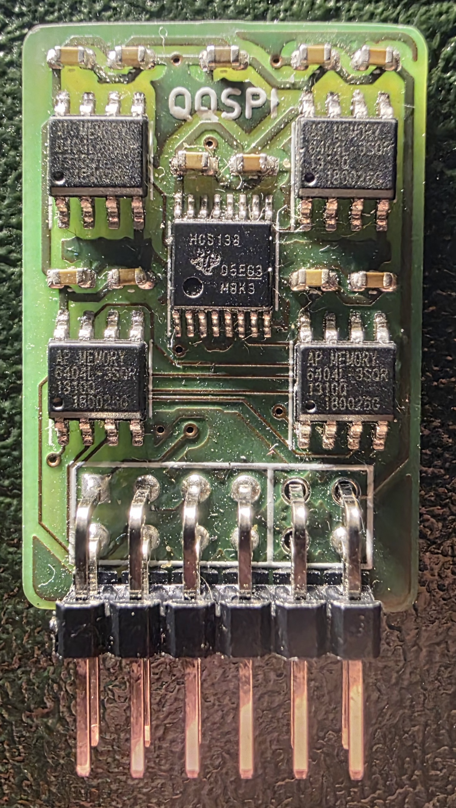
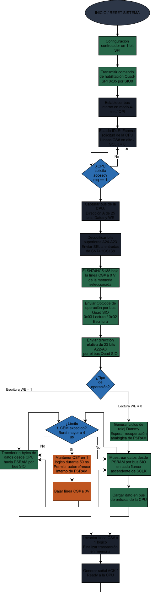
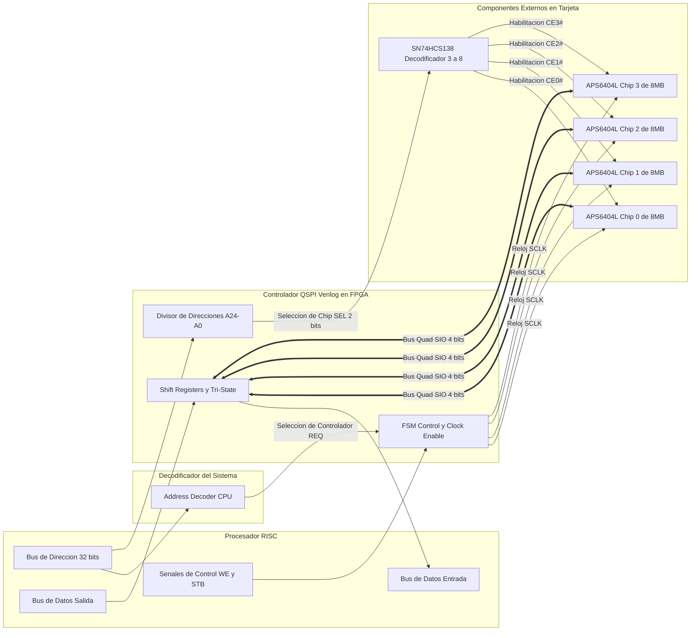
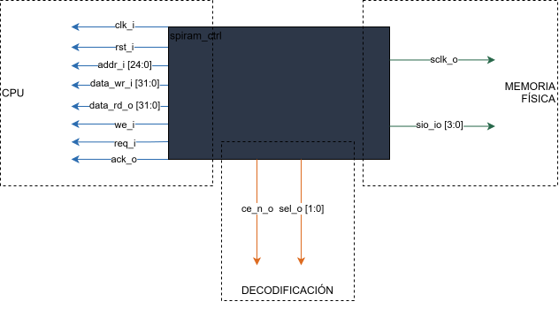
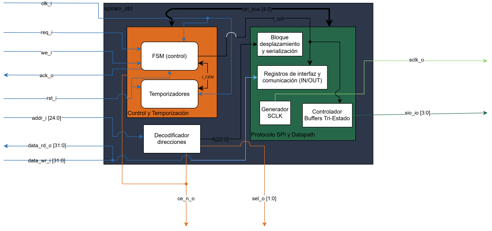

# SPIRAM_CTRL

Este espacio está reservado para la especificación de la información relevante del funcionamiento de la memoria RAM mediante protocolo `SPI`. 

Con base en esta imagen se puede determinar el tipo de módulo con el que se va a trabajar, y en consecuencia, empezar la creación de su diagrama.
En este sistema la memoria `RAM` va a trabajar como almacenador de información referente a variables de ejecución de algún programa. 

# Consideraciones. 

1. La información relevante del protocolo se encuentra en [Protocolo SPI](../spiram_ctrl/SPI%20Protocol.md)
2. La memoria `RAM` es un dispositivo externo y no es parte de la `FPGA`, sin embargo, el controlador que se desarrolla sí está en la `FPGA`. Se hace necesaria la aclaración para denotar que existen dos dominios; `BUS LOCAL` (lado `CPU`) que trabaja con el reloj del sistema generado por el oscilador de cristal y `BUS EXTERNO` (lado periféricos) que trabaja con un reloj independiente comandado por el protocolo -`SPI` en nuestro caso- con base en la capacidad del periférico en cuestión.
3. El dispositivo que se va a usar consiste en una `RAM` `QUAD-SPI` (para más información respecto a cómo funciona esto remitirse a [Protocolo SPI](/SPI%20Protocol.md). Consiste en un chip [`HCS138`](../Datasheets/SN74HCS138.pdf) (05EG3/M8K3) y 4 memorias [`APS6404L-3SQ`](../Datasheets/APS6404L_3SQR.pdf). Con base en las especificaciones de estos dispositivos el modo de operación SPI seleccionado es el `MODO 0`.

## Especificaciones Técnicas

Un vistazo rápido de los datos presentes en los datasheets pero relevantes para el controlador se muestran en las tablas. 

### Componentes de Memoria

| Componente | Parámetro Técnico | Valor / Especificación | Relevancia para el Controlador Verilog / FPGA |
| :--- | :--- | :--- | :--- |
| **Memoria PSRAM** (`APS6404L-3SQR`) *(4 integrados)* | **Organización / Capacidad** | $64\text{ Mbit}$ ($8\text{ MB}$) por chip. Total conjunto ($4 \times 8\text{ MB}$): **$32\text{ MB}$** ($256\text{ Mbit}$).  | Determina el tamaño total del mapa de memoria ($A[24:0]$) que el decodificador de la CPU debe direccionar. |
| | **Tensión de Trabajo ($V_{DD}$)** | $2.7\text{ V}$ a $3.6\text{ V}$ ($3.3\text{ V}$ nominal). | Define el nivel lógico de los I/O de la FPGA (`LVCMOS33`). Si la FPGA usa $1.8\text{ V}$ o $2.5\text{ V}$, requiere adaptación de nivel (*Level Shifter*). |
| | **Frecuencia de Reloj ($SCLK$)** | **Hasta $84\text{ MHz}$** en modo *Linear Burst* (cruza fronteras de página de $1\text{ KB}$). **Hasta $133\text{ MHz}$** en *32-Byte Wrapped Burst* (a $3.0\text{ V}$). | El divisor de reloj o *Clock Enable* en Verilog debe garantizar que $SCLK \le 84\text{ MHz}$ para operaciones de ráfaga lineal continua.|
| | **Protocolo e Interfaz** | SPI ($1\times \text{I/O}$) / QPI Quad-SPI ($4\times \text{I/O}$, $SIO[3:0]$). | La FSM en Verilog debe manejar transiciones entre $1\text{ bit/ciclo}$ (comando) y $4\text{ bits/ciclo}$ (dirección/datos en QSPI). |
| | **Gestión de Refresco** | Automático e Interno (*Self-Managed PSRAM*).  | **Ventaja crítica:** No se necesita implementar un controlador DRAM con ciclos de refresco periódicos en Verilog; la memoria se comporta como SRAM estática.  |
| | **Límite $t_{CEM}$ (Burst Duration)** | Máximo $\approx 4\mu\text{s}$ a $8\mu\text{s}$ con `CE#` activado continuo.  | La FSM debe desmarcar `CE#` (ponerlo en alto) tras completar un bloque de lectura/escritura para que la PSRAM ejecute su autorrefresco interno. |
| **Decodificador** (`SN74HCS138`) | **Función** | Decodificador / Demultiplexor de 3 a 8 líneas con entradas Schmitt-Trigger. | Actúa como selector de chip (*Chip Select*) enviando la señal `CE#` activa en bajo ($0\text{ V}$) a cada uno de los 4 chips de memoria según las líneas de selección. |
| | **Tensión de Trabajo ($V_{CC}$)** | $2.0\text{ V}$ a $6.0\text{ V}$ ($3.3\text{ V}$ o $5.0\text{ V}$ típicamente). | Garantiza compatibilidad de voltaje directo con los niveles $3.3\text{ V}$ provenientes de los pines de la FPGA y las memorias. |
| | **Tiempo de Propagación ($t_{pd}$)** | $\approx 9\text{ ns}$ a $15\text{ ns}$ (dependiendo de $V_{CC}$). | **Latencia del controlador:** Se debeañadir esta demora en el análisis de tiempos (*Setup/Hold*) de la señal `CE#` que sale de la FPGA antes de iniciar la primera instrucción $SCLK$. |
| | **Entradas Schmitt-Trigger** | Tolerancia e inmunidad al ruido en los flancos de conmutación. | Elimina rebotes o ruidos indeseados en las líneas de control que selecciona la CPU antes de llegar a la PSRAM. |

---

## Mapeo de Selección de Chip (Decodificador `SN74HCS138`)

| Selección Verilog (`SEL[1:0]`) | Salida Activa `SN74HCS138` | Memoria Habilitada | Rango de Direcciones Hexadecimal ($32\text{ MB}$ Total) |
| :---: | :---: | :---: | :---: |
| `2'b00` | $Y_0$ (`0V` / Bajo) | `APS6404L` Chip 0 ($8\text{ MB}$) | `0x0000_0000` — `0x007F_FFFF`  |
| `2'b01` | $Y_1$ (`0V` / Bajo) | `APS6404L` Chip 1 ($8\text{ MB}$) | `0x0080_0000` — `0x00FF_FFFF`  |
| `2'b10` | $Y_2$ (`0V` / Bajo) | `APS6404L` Chip 2 ($8\text{ MB}$) | `0x0100_0000` — `0x017F_FFFF`  |
| `2'b11` | $Y_3$ (`0V` / Bajo) | `APS6404L` Chip 3 ($8\text{ MB}$) | `0x0180_0000` — `0x01FF_FFFF`  |

## Mapeo físico del periférico

Partiendo del principio mencionado al inicio del documento, el dispositivo que se está trabajando es un periférico existente, por lo que es necesario visualizarlo. A continuación se muestra la imagen del dispositivo físico bajo el cual se está trabajando. 

  

Con ello en mente, se aplicó ingeniería inversa para determinar las conexiones de cada uno de los pines tanto de las memorias `APS6404L-3SQ` como del decodificador principal `HCS138`. Para facilitar la visualización de las conexiones se realizó una codificación por colores independiente a la posteriormente expresada para los diagramas. Las flechas en los pines indican el flujo de la señal siendo dual en los canales correspondientes a la comunicación por QSPI y única en las demás líneas de control.

  

# Diagrama de flujo [IA asistido]

Con base en la información presente en [Protocolo SPI](/SPI#20Protocol.md) y referenciando el hardware disponible se puede establecer el flujo del proceso que debe realizar el controlador durante la comunicación con la `CPU` y la `RAM`.

## 🎨 Especificación del Código de Colores para Diagramas de flujo (Draw.io)

Para garantizar consistencia visual y facilitar la lectura técnica de los diagramas de flujo del controlador QSPI, se aplica la siguiente paleta semántica según el tipo y función de cada bloque:

| Categoría de Bloque | Color Sugerido (HEX) | Muestra | Propósito y Significado Técnico |
| :--- | :---: | :---: | :--- |
| **Inicio / Fin de Flujo** | `#2D3748` | ⬛ | Delimita los puntos de entrada y salida de las funciones, rutinas o sub-diagramas. |
| **Puntos de Decisión** | `#2B6CB0` | 🟦 | Resalta las evaluaciones de condiciones lógicas y bifurcaciones de control (`req == 1`, `WE == 1`, `t_CEM > 4us`). |
| **Acciones del Bus SIO / Protocolo** | `#276749` | 🟩 | Identifica la transmisión activa de comandos, direcciones o datos hacia/desde las PSRAM (`0x35`, `0x03`, `0x02`). |
| **Control Interno y Registros** | `#1A202C` | ⬛ | Indica operaciones internas de la FPGA, como registro de buses, decodificación para `SEL[1:0]` o manejo de $CS$\#. |
| **Pausas de Seguridad / Alertas** | `#C05621` | 🟧 | Reservado exclusivamente para la interrupción de $t_{\text{CEM}}$ (pausa de $50\text{ ns}$ para autorrefresco de memoria). |

  

1. **Óvalos (`Inicio / Reset`):** Indican el arranque del hardware desde que la FPGA recibe alimentación o una señal de reset.
2. **Rectángulos (`Procesos`):**
   * **`Configurar / Transmitir QPI`:** Ocurren una sola vez al encender el sistema para pasar las memorias a modo de 4 bits.
   * **`Decodificar bits A[24:23]`:** Transforma la dirección de la CPU en las señales `SEL[1:0]` que van hacia el `SN74HCS138`.
   * **`El SN74HCS138 baja la línea CS#`:** Habilita el chip de memoria correcto *antes* de enviar la dirección y los datos.
3. **Rombos (`Decisiones`):**
   * **`¿CPU solicita acceso?`:** Evalúa si la CPU colocó una dirección válida asignada a la RAM.
   * **`¿Tipo de operación?`:** Divide el camino entre el ciclo de escritura directa o el ciclo de lectura (que requiere *Dummy Cycles* de espera antes de capturar el dato).
   * **`¿Límite t_CEM excedido?`:** Verifica si la transferencia fue demasiado larga para liberar `CE#` y permitir que la memoria se autorrefresque.
  
## Diagramas de funciones 

Puesto que algunas de las funciones requieren de explicación adicional respecto a lo que se indica en el diagrama principal, las versiones ampliadas (con misma codificación de colores) se muestran a continuación).

### Configuración 1-bit SPI

  

### Transmisión comando habilitación Q-SPI

  

### Configuración bus interno a 4-bit SPI

  

# Diagrama de bloques [IA asistido]

Con base en la información presentada en el diagrama de flujo previo, se hace el diagrama de bloques correspondiente a dicho sistema. 

## Código de Colores diagramas de bloques Draw.io

Igual que en el punto anterior, para facilitar la visualización de los "dominios" presentes en el funcionamiento de este controlador, se dividen entre distintos colores como se muestra a continuación: 

| Dominio / Componente | Color Sugerido (HEX) | Muestra | Descripción y Señales Agrupadas |
| :--- | :---: | :---: | :--- |
| **Núcleo del Controlador (RTL)** | `#2D3748` | ⬛ | Bloque central de la caja negra que representa la lógica secuencial y la FSM dentro de la FPGA. |
| **Dominio del Procesador** | `#2B6CB0` | 🟦 | Agrupa todas las líneas de control y buses hacia la CPU (`clk_i`, `rst_i`, `addr_i [24:0]`, `data_wr_i`, `data_rd_o`, `we_i`, `req_i`, `ack_o`). |
| **Dominio de Memoria Física** | `#276749` | 🟩 | Identifica las líneas de alta velocidad orientadas al bus de las PSRAM (`sclk_o`, `sio_io [3:0]`). |
| **Dominio de Decodificación** | `#DD6B20` | 🟧 | Señala las líneas de selección hacia el exterior para el decodificador `SN74HCS138` (`sel_o [1:0]`, `ce_n_o`). |

Un vistazo inicial de las conexiones del controlador entre los demás elementos de la FPGA se representa con el diagrama a continuación. Cabe aclarar que este diagrama no es detallado, así que requiere la ampliación detallada del controlador.

Con el diagrama de bloques previo y la representación general de las conexiones que deben existir entre el controlador y los demás componentes del sistema, se hace de forma particular, el denominado diagrama de caja negra del controlador `spiram_ctrl`: 

  

A continuación se detalla la nomenclatura asignada a cada una de las líneas y buses de Entrada/Salida que componen la interfaz externa del controlador QSPI, agrupadas por su dominio funcional:

## 1. Interfaz con el Procesador (Dominio CPU)
| Nombre de Señal | Tipo / Ancho | Dirección | Descripción Funcional |
| :--- | :---: | :---: | :--- |
| `clk_i` | 1 bit | Entrada | Reloj maestro del sistema (proveniente de la FPGA). |
| `rst_i` | 1 bit | Entrada | Señal de reinicio global (*Reset*) del sistema. |
| `addr_i` | 25 bits `[24:0]` | Entrada | Bus de direcciones completo de la CPU para direccionar el espacio de memoria. |
| `data_wr_i` | 32 bits | Entrada | Bus de datos de escritura enviados por el procesador hacia el controlador. |
| `data_rd_o` | 32 bits | Salida | Bus de datos leídos desde la PSRAM y devueltos hacia el procesador. |
| `we_i` | 1 bit | Entrada | Señal de habilitación de escritura (`1` = Escritura, `0` = Lectura). |
| `req_i` | 1 bit | Entrada | Bandera de solicitud de acceso (*Strobe* o petición activa de la CPU). |
| `ack_o` | 1 bit | Salida | Señal de reconocimiento o listo (*Ready/ACK*) para indicar fin de transacción a la CPU. |

## 2. Interfaz con el Decodificador y Selección (Dominio de Direccionamiento)
| Nombre de Señal | Tipo / Ancho | Dirección | Descripción Funcional |
| :--- | :---: | :---: | :--- |
| `sel_o` | 2 bits `[1:0]` | Salida | Bits superiores de dirección ($A[24:23]$) conectados a las entradas de selección del `SN74HCS138`. |
| `ce_n_o` | Líneas de habilitación | Salida | Líneas de selección de chip activas en bajo (`CS#`) habilitadas hacia el banco de memorias PSRAM. |

## 3. Interfaz con las Memorias Físicas (Dominio PSRAM)
| Nombre de Señal | Tipo / Ancho | Dirección | Descripción Funcional |
| :--- | :---: | :---: | :--- |
| `sclk_o` | 1 bit | Salida | Señal de reloj serial generada por el controlador para sincronizar la comunicación con la PSRAM. |
| `sio_io` | 4 bits `[3:0]` | Bidireccional | Bus Quad SIO (`SIO0`, `SIO1`, `SIO2`, `SIO3`) para la transferencia multiplexada de comandos, direcciones y datos. |

Haciendo un desarrollo más avanzado del diagrama de bloques del controlador, se dividen dos subsistemas principales encargados de la mayor parte del proceso y otro bloque adicional encargado de verificar las direcciones. 

  

## 🔌 Explicación de Conexiones (Caja Negra)

La siguiente tabla detalla las líneas de interfaz externa del controlador QSPI, su subsistema interno de destino y la explicación de su interconexión:

| Señal / Bus | Ancho / Tipo | Subsistema de Destino | Justificación Técnica |
| :--- | :---: | :--- | :--- |
| `clk_i` | 1 bit (Entrada) | Control y Temporización (FSM / Timers) | Sincroniza todas las operaciones secuenciales de la máquina de estados y alimenta los contadores de tiempo ($t_{\text{CEM}}$ y *Dummy Cycles*). |
| `rst_i` | 1 bit (Entrada) | Control y Temporización (FSM / Timers) | Permite llevar la FSM y los registros internos a un estado determinista y seguro tras el encendido o reinicio global. |
| `addr_i` | 25 bits `[24:0]` (Entrada) | Camino de Datos (Decodificador Interno) | Proporciona el rango completo para direccionar 32 MB; los bits superiores ($A[24:23]$) seleccionan el chip mediante el `SN74HCS138`, y el resto gestiona el offset. |
| `data_wr_i` | 32 bits (Entrada) | Camino de Datos (Staging Register) | Recibe la palabra paralela completa de la CPU para ser descompuesta secuencialmente en bloques de 4 bits (*nibbles*) hacia el bus QPI. |
| `data_rd_o` | 32 bits (Salida) | Camino de Datos (SIPO Register) | Ensambla los *nibbles* leídos de la memoria física para reconstruir y devolver la palabra paralela de 32 bits hacia el procesador. |
| `we_i` | 1 bit (Entrada) | Control y Temporización (FSM) | Define la bifurcación lógica en la FSM para habilitar las rutas de escritura (`0x02`) o lectura (`0x03`) según lo requiera la CPU. |
| `req_i` | 1 bit (Entrada) | Control y Temporización (FSM) | Actúa como la bandera de solicitud (*strobe*) que saca a la máquina de estados del reposo (`IDLE`) para atender la petición de acceso. |
| `ack_o` | 1 bit (Salida) | Control y Temporización (FSM) | Notifica de forma síncrona al procesador que la transacción de lectura o escritura ha finalizado exitosamente. |
| `sel_o` | 2 bits `[1:0]` (Salida) | Camino de Datos (Decodificador Interno) | Conecta los bits de selección con el decodificador externo `SN74HCS138` para habilitar físicamente el banco de memoria correcto. |
| `ce_n_o` | Líneas de Habilitación (Salida) | Control y Temporización / FSM | Gobierna la señal de selección activa en bajo ($\text{CS}$) para permitir los ciclos de autorrefresco y cumplir con el límite $t_{\text{CEM}}$. |
| `sclk_o` | 1 bit (Salida) | Protocolo SPI (SCLK Gen) | Genera la señal de reloj serial externa sincronizada para la transferencia de comandos, direcciones y datos en la PSRAM. |
| `sio_io` | 4 bits `[3:0]` (Bidireccional) | Protocolo SPI (Buffers Tri-estado) | Administra el bus Quad SPI de alta velocidad mediante control de alta impedancia (`Hi-Z`) para la transmisión multiplexada de datos. |

Internamente se pueden apreciar algunas señales dentro del controlador, la descripción de cada una se especifica a continuación. 

| Señal del Bus | Ancho / Tipo | Subsistema de Destino | Descripción Funcional / Justificación |
| :--- | :---: | :--- | :--- |
| `ctrl_bus` | 4 bit / {Salida y entrada) | FSM y SPI/Datapath | Bus de control interno que contiene las señales de `shift_en`, `sample_en`, `dummy_en`,  `load_regs`, `byte_done` y `shift_empty`. |
| `load_regs` | 1 bit (Salida FSM) | Registros de Interfaz (Staging) | Ordena la captura y el almacenamiento temporal de la dirección de 25 bits (`addr_i`) y los datos de escritura (`data_wr_i`) provenientes de la CPU al detectarse el requerimiento (`req == 1`). |
| `shift_en` | 1 bit (Salida FSM) | Bloque de Desplazamiento y Serialización | Habilita el desplazamiento sincrónico de los bits o *nibbles* (4 bits) a través del bus QPI físico (`sio_io`) al ritmo del reloj `sclk_o`. |
| `dummy_en` | 1 bit (Salida FSM) | Generador SCLK / Control SPI | Dispara la secuencia de ciclos de reloj de espera (*Dummy Cycles*) requeridos por la PSRAM antes de iniciar la fase de muestreo de lectura. |
| `sample_en` | 1 bit (Salida FSM) | Bloque SIPO / Ensamblador de Datos | Habilita el muestreo y la captura de los *nibbles* entrantes desde la memoria en cada flanco ascendente de `sclk_o` durante las operaciones de lectura. |
| `byte_done` | 1 bit (Salida SPI/Datapath) | FSM | El contador interno del datapath avisa que los $n$ bytes ya terminaron de enviarse o recibirse, permitiendo a la FSM salir del bucle de ráfaga y levantar $\text{CS}$#. |
| `shift_empty` | 1 bit (Salida SPI/Datapath) | FSM | El bloque de desplazamiento avisa que los 4 bits actuales ya completaron su ciclo en el bus SIO y se requiere cargar el siguiente nibble. |
| `t_CEM` | 1 bit (Salida Temporizador y FSM) | FSM y Temporizador | Señal de interrupción indicada desde el temporizador para dar inicio a la secuencia de refresco de la memoria para evitar la corrupción de datos. |
| `t_cph` | 1 bit (Salida FSM) | Registros de interfaz y controlador de buffers tri-estado | Señal de recuperación para la interrupción temporal del avance del registro y forzar CS# a nivel alto durante 50us. |
